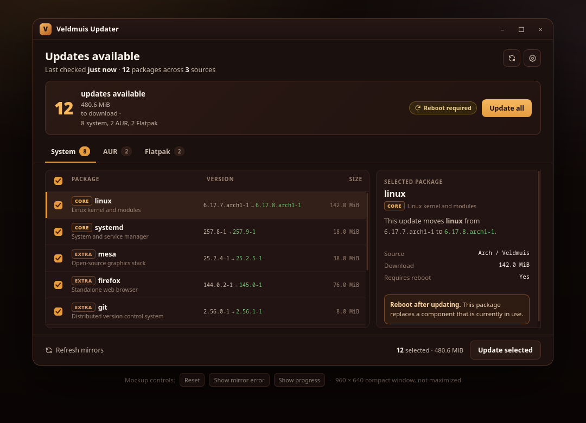

# Veldmuis Updater — Design Plan

Status: design proposal  
Related: `veldmuis-update`, `veldmuis-mirrorlist`, muis architecture  
Mockup: [`updater-mockup.html`](updater-mockup.html) · [PNG preview](updater-mockup.png)

## 1. Purpose

Veldmuis currently has a terminal-first update path:

```sh
sudo veldmuis-update
```

That wrapper is the right recovery and scripting path, but it is not a desktop
experience. The goal is a compact graphical updater that:

- shows what will change before anything runs;
- updates the host system with `pacman -Syu`;
- updates Flatpak applications and runtimes when Flatpak is installed;
- updates AUR packages when a supported AUR helper is installed;
- keeps the Veldmuis mirror retry behavior when a mirror returns a bad or
  missing file;
- never becomes a full package manager.

It should feel like a small, focused Veldmuis application, not a replacement
for Discover or Pamac.

## 2. Goals And Non-Goals

### Goals

- One window, compact by default, usable without maximizing.
- Check and apply updates for the host system, Flatpak, and AUR.
- Clear source separation: official Arch/Veldmuis, AUR, Flatpak.
- Safe privilege handling through polkit, not a GUI running as root.
- The same mirror-refresh-and-retry behavior as `veldmuis-update`.
- A readable log and a clear failure state.
- Reboot guidance when the update replaces the running kernel, initramfs,
  systemd, or graphics stack.
- Packaging as a normal Veldmuis package with a desktop entry and polkit
  policy.

### Non-Goals

- Installing or removing arbitrary packages.
- Browsing repositories, searching, or managing package groups.
- Replacing `pacman`, `paru`/`yay`, or `flatpak` CLIs.
- Managing Snaps, AppImages, firmware, or containers in the first version.
- Partial upgrades. The system path always uses a full `pacman -Syu`.
- Running AUR helpers as root.
- Hiding AUR risk. AUR remains user-supported and visibly warned.

## 3. What “Like muis” Means

muis is the closest existing reference in the Veldmuis ecosystem. Its shape is:

```text
crates/muis-core/    models, config, IPC, no UI dependencies
crates/muis-shell/   Tauri 2 window, WebKitGTK, commands and events
crates/muis-worker/  one process per PTY session, JSON-line IPC
crates/muis-notify/  small helper binary
crates/muis-agent/   optional helper
src-ui/              TypeScript + Vite frontend, embedded in the shell
tests/fixtures/      shared IPC contract used by Rust and TypeScript tests
data/muis.desktop    desktop entry
```

The updater should reuse those patterns:

- a Rust workspace with a UI-free core crate;
- Tauri 2 + WebKitGTK for the window;
- a TypeScript/Vite frontend embedded in the binary;
- JSON-line IPC with a shared fixture that locks Rust and TypeScript together;
- one small privileged helper instead of a root GUI;
- a separate release artifact that Veldmuis packages, like `veldmuis-muis`.

The updater is not a fork of muis. It reuses the architecture, not the terminal
code.

## 4. Proposed Workspace

A separate repository, `veldmuis-updater`, is the recommended shape. It keeps
the Rust/Node/Tauri build out of the main distro repository and matches how
`veldmuis-muis` is delivered as a pinned prebuilt release.

```text
crates/updater-core/    update models, source adapters, parsers, plan, IPC
crates/updater-shell/   Tauri 2 window, commands, event bridge
crates/updater-helper/  privileged pacman/Flatpak/mirror actions
crates/updater-cli/     optional headless check/apply and JSON output
crates/updater-worker/  optional PTY worker for interactive AUR/Flatpak output
src-ui/                 TypeScript + Vite frontend
tests/fixtures/         shared updater IPC contract
data/                   desktop entry, polkit policy, icons
```

If the project stays in the Veldmuis repository instead, the same layout can
live under `updater/` and be built by the package pipeline. The separate repo
is preferred because the build toolchain is much larger than the distro
repository's current package set.

### Crate Responsibilities

`updater-core`

- `UpdateSource`, `UpdateItem`, `UpdatePlan`, `ApplyRequest` models.
- Source adapters and output parsers for pacman, Flatpak, and AUR helpers.
- Plan selection and ordering.
- Reboot detection.
- Config and paths.
- No Tauri, no GTK, no root calls.

`updater-shell`

- Tauri 2 window and capabilities.
- Commands: `check_updates`, `apply_updates`, `refresh_mirrors`,
  `cancel_apply`, `load_settings`, `save_settings`, `open_log`.
- Events: `check-started`, `check-finished`, `plan`, `apply-started`,
  `item-started`, `item-finished`, `log`, `apply-finished`, `error`.
- No package-manager logic beyond calling core and the helper.

`updater-helper`

- Runs as root through polkit.
- Accepts only fixed actions, never arbitrary commands.
- Actions: `apply-system`, `apply-flatpak-system`, `refresh-mirrors`.
- Streams JSON progress and log lines to the caller.
- Uses absolute binary paths and a sanitized environment.

`updater-cli` (optional, phase 1)

- `veldmuis-updater --check --json`
- `veldmuis-updater --apply system,flatpak`
- Useful for tests, headless machines, and a future rewrite of the bash
  `veldmuis-update` wrapper.

`updater-worker` (optional, phase 3)

- PTY-backed process for AUR helpers and interactive Flatpak/pacman output.
- Reuses the muis `portable-pty` worker pattern.
- Lets the UI show real terminal output and accept prompts without pretending
  that `--noconfirm` is always safe.

## 5. Update Sources

### 5.1 System: pacman

Check:

- Use `checkupdates` from `pacman-contrib` when available. It creates a
  temporary sync database and lists pending upgrades without touching the
  system database.
- Parse the `name oldver -> newver` output.
- If `checkupdates` is unavailable, fall back to a read-only libalpm check in
  `updater-core`.
- Treat the Veldmuis repositories and Arch repositories as one source: the
  user sees “System”, with repo badges (`core`, `extra`, `multilib`,
  `veldmuis-core`, `veldmuis-extra`).

Apply:

- Always a full `pacman -Syu`. Never `pacman -Sy` followed by a partial
  install.
- Run through the privileged helper, not through a root Tauri process.
- Stream output to the UI log.
- On a retrieval failure, reuse the `veldmuis-update` behavior:
  - remove the failing mirror from the current mirrorlist;
  - retry;
  - if that fails, run `veldmuis-refresh-arch-mirrors` and retry once.
- Detect the pacman database lock and show “another package manager is
  running” instead of failing with a raw error.

### 5.2 AUR

Detection:

- Look for `paru`, `yay`, then `pikaur` on `PATH`.
- If none is present, hide the AUR source entirely.
- If one is present, show the AUR tab with a persistent “user-supported”
  warning.

Check:

- `paru -Qua` or `yay -Qua`, parsed as `name oldver -> newver`.
- Never run the helper as root.

Apply:

- Run the helper as the desktop user, in a PTY-backed worker.
- Prefer an interactive view over `--noconfirm` so PKGBUILD review prompts and
  build failures are visible.
- Show a warning before the first AUR update in a session:
  “AUR packages are not part of Veldmuis support. Review build files before
  updating.”
- Do not offer AUR updates when the helper is running as root.
- Do not mix AUR packages into the system count or the system package list.

### 5.3 Flatpak

Detection:

- `flatpak` on `PATH`.
- System installation and user installation are separate.
- If Flatpak is not installed, hide the Flatpak source.

Check:

- System: `flatpak remote-ls --updates --columns=application,version,branch,origin,size`
- User: `flatpak --user remote-ls --updates --columns=...`
- Parse applications and runtimes separately.

Apply:

- User updates run as the desktop user: `flatpak --user update -y`.
- System updates run through the privileged helper:
  `flatpak update -y` with polkit authorization.
- Show runtime updates separately because they can be large.

### 5.4 Ordering And “Update All”

When multiple sources are selected:

1. System first, because AUR builds and some Flatpak integrations expect the
   updated base libraries.
2. AUR second, rebuilt against the updated system.
3. Flatpak last, because it is independent and can be large.

The UI shows the order before starting. “Update all” is a sequence, not a
parallel operation. Each source gets its own progress row and log section.

## 6. Privilege And Security Model

The GUI never runs as root. The privileged surface is deliberately small.

```text
Tauri UI (user)
  ├─ updater-core (user): check, parse, plan
  ├─ AUR helper (user): paru/yay, PTY-backed
  ├─ Flatpak user update (user)
  └─ pkexec / polkit
       └─ updater-helper (root)
            ├─ pacman -Syu
            ├─ flatpak update -y
            └─ veldmuis-refresh-arch-mirrors
```

Rules:

- The helper accepts a fixed action enum, not a command string.
- Use `Command::new` with argument arrays; no shell interpolation.
- Use absolute paths for `pacman`, `flatpak`, and the mirror helper.
- Sanitize `PATH`, `LC_ALL`, and other environment variables for parsing.
- Never pass user-provided package names to the system update path. The system
  path is a full upgrade.
- AUR helpers always run as the user. Refuse to run them as root.
- The polkit policy is installed by the package and is root-owned.
- Logs go to a user-readable location; do not log environment secrets.
- The helper should support a `--dry-run` mode for tests.

For the first version, `pkexec` is enough:

```text
pkexec /usr/lib/veldmuis/updater-helper apply-system
```

If progress and cancellation become awkward through `pkexec`, move to a
D-Bus service with a polkit action and keep the same fixed action enum.

## 7. IPC And Data Model

Use JSON types shared by Rust and TypeScript, with a fixture file that both
sides test against, exactly like muis.

```rust
enum UpdateSource { System, Aur, FlatpakSystem, FlatpakUser }

struct UpdateItem {
    id: String,
    source: UpdateSource,
    name: String,
    repo: String,
    current_version: String,
    new_version: String,
    download_bytes: u64,
    installed_bytes: u64,
    summary: String,
    requires_reboot: bool,
    warning: Option<String>,
}

struct UpdatePlan {
    items: Vec<UpdateItem>,
    total_download_bytes: u64,
    requires_reboot: bool,
    checked_at: String,
    warnings: Vec<String>,
}
```

Commands:

- `check_updates(sources) -> UpdatePlan`
- `apply_updates(sources) -> ApplyResult`
- `refresh_mirrors() -> MirrorResult`
- `cancel_apply() -> ()`
- `load_settings() -> Settings`
- `save_settings(settings) -> ()`

Events:

- `check-started`
- `check-finished`
- `plan`
- `apply-started`
- `item-started`
- `item-finished`
- `log`
- `apply-finished`
- `error`

The fixture should cover at least:

- a system-only plan;
- a mixed system/AUR/Flatpak plan;
- an up-to-date plan;
- a retrieval error;
- an AUR warning item;
- a reboot-required item.

## 8. UI And UX

### Window

- Default size: 960 × 640.
- Minimum size: 760 × 520.
- Resizable, not maximized by default.
- Remember the last size and position.
- Native decorations or a compact custom titlebar; either is fine, but the
  window must not look like a full-screen application.

### Main View

- Header: “Veldmuis Updater”, last-checked time, refresh button, settings.
- Summary card: update count, total download size, reboot chip, “Update all”.
- Source tabs: System, AUR, Flatpak, each with a count. Hidden when the source
  is unavailable.
- Package list: checkbox, repo badge, name, current → new version, size,
  status.
- Details pane: selected package description, version change, size, AUR
  warning, reboot note.
- Footer: “Refresh mirrors”, selected count/size, “Update all”.

### Progress View

- Overall progress bar.
- One row per source, with its own progress.
- Current package name and phase.
- Streaming log, collapsed by default.
- Cancel button with a warning that interrupting pacman can leave a partial
  transaction.
- Completion state with “Reboot required” and a reboot button when needed.

### Error State

- A banner above the list:
  “Mirror returned 404 for a package signature.”
- Actions: “Refresh mirrors and retry”, “Open log”.
- The error state must not pretend the system is up to date.

### Empty State

- “System is up to date.”
- Last checked time.
- “Check again” button.
- If AUR or Flatpak is not installed, do not show an empty tab for it.

### Visual Language

- Veldmuis dusk palette: warm dark surfaces, ember accent, cream text.
- Dense but readable: 13–14 px body, 12 px metadata.
- No hero image, no large empty marketing space.
- Repo badges: `core`, `extra`, `multilib`, `veldmuis-core`,
  `veldmuis-extra`, `AUR`, `flathub`.
- Clear warning color for AUR and reboot-required items.

See [`updater-mockup.html`](updater-mockup.html) for the compact layout and the
progress/error states.

## 9. Packaging And Integration

New package: `veldmuis-updater`.

Contents:

```text
/usr/bin/veldmuis-updater
/usr/lib/veldmuis/updater-helper
/usr/lib/veldmuis/updater-worker        (phase 3)
/usr/share/applications/org.veldmuislinux.updater.desktop
/usr/share/polkit-1/actions/org.veldmuislinux.updater.policy
/usr/share/icons/hicolor/.../apps/veldmuis-updater.png
```

Dependencies:

- `gtk3`, `webkit2gtk-4.1` (Tauri runtime)
- `pacman`, `pacman-contrib` (`checkupdates`)
- `polkit`
- `veldmuis-mirrorlist` (`veldmuis-refresh-arch-mirrors`)

Optional dependencies:

- `flatpak` for the Flatpak source
- `paru` or `yay` for the AUR source

Desktop entry:

```ini
[Desktop Entry]
Type=Application
Name=Veldmuis Updater
Comment=Review and apply system, Flatpak, and AUR updates
Exec=veldmuis-updater
Icon=veldmuis-updater
Categories=System;PackageManager;
Keywords=update;upgrade;pacman;flatpak;aur;
Terminal=false
StartupWMClass=veldmuis-updater
```

The existing `veldmuis-update` CLI stays in `veldmuis-mirrorlist` as the
recovery path. The GUI is additive; it does not replace the CLI. A later phase
can reimplement the wrapper on top of `updater-cli` if that becomes useful.

## 10. Testing

- Rust unit tests for every parser: `checkupdates`, `paru -Qua`, `yay -Qua`,
  `flatpak remote-ls --updates`.
- Shared IPC fixture tests on both Rust and TypeScript sides.
- Vitest tests for selection, totals, source filtering, and state transitions.
- Playwright or Selenium tests for the mockup and the real UI.
- Fake binaries in `tests/fixtures/bin/` so checks and plans can be tested
  without root or a real package manager.
- A dry-run helper mode for apply sequencing.
- A VM test for a real system update, a Flatpak update, and an AUR update.
- A mirror-failure test using a fake `pacman` that prints a 404, proving the
  retry path removes the failing mirror and refreshes once.

## 11. Phased Delivery

### Phase 0 — Design

- This plan and the HTML mockup.
- Agree on window size, source order, and AUR/Flatpak scope.

### Phase 1 — Core And CLI

- `updater-core` models and parsers.
- `updater-cli --check --json` for system, Flatpak, and AUR detection.
- Fake-binary tests.
- No GUI, no root helper yet.

### Phase 2 — Tauri Shell And System Updates

- Tauri 2 window and TypeScript frontend.
- System check and apply through `pkexec`/polkit.
- Mirror retry integration.
- Reboot detection.
- Log view and error state.

### Phase 3 — Flatpak And AUR

- Flatpak system/user detection and apply.
- AUR helper detection, PTY worker, warning flow.
- Source ordering and per-source progress.

### Phase 4 — Packaging And Polish

- `veldmuis-updater` package, desktop entry, polkit policy.
- Docs and screenshots.
- Notifications, settings, remembered window size.
- Release pin in the Veldmuis package repository.

### Phase 5 — Optional

- Arch news integration.
- Per-package selection.
- Update history.
- Firmware updates via `fwupd`.
- A D-Bus helper service if `pkexec` becomes limiting.

## 12. Risks And Open Questions

- **`checkupdates` dependency.** It comes from `pacman-contrib`. Is that
  acceptable as a hard dependency, or should the first version use libalpm
  directly?
- **AUR interactivity.** `--noconfirm` is not always safe. The PTY worker is
  the right answer, but it is extra work. Confirm that phase 3 is acceptable
  before promising AUR updates in the first release.
- **Flatpak system/user split.** The UI needs to make it clear which
  installation is being updated. A single “Flatpak” tab may hide that; a
  sub-label per row is probably enough.
- **`pkexec` and Wayland.** The polkit agent must work in the KDE Wayland
  session. Test early; fall back to a D-Bus helper if needed.
- **Partial upgrades.** The system path must never expose a per-package
  “update” button that bypasses `pacman -Syu`.
- **AUR trust.** The updater must not make AUR look like an official source.
  Keep the warning visible, not hidden in settings.
- **Reboot detection.** Be conservative: kernel, kernel modules, initramfs,
  systemd, and graphics drivers. Do not claim a reboot is required for every
  update.
- **Window size.** 960 × 640 is the target. Test on 1366 × 768 and 1920 × 1080
  with scaling; the window must not require maximizing.
- **Source availability.** AUR and Flatpak tabs must disappear cleanly when
  the tools are absent, not show empty or broken states.
- **Logs.** Decide whether logs live under `~/.local/state/veldmuis-updater/`
  or `/var/log/veldmuis-updater/`. User logs are simpler; the helper can write
  a root-owned log for system actions.

## 13. Mockup



Open [`updater-mockup.html`](updater-mockup.html) in a browser. It is a
standalone file with no external assets. It demonstrates:

- the compact 960 × 640 window;
- System, AUR, and Flatpak sources;
- package selection and the details pane;
- the AUR warning;
- the reboot-required chip;
- the progress view;
- the mirror-error banner and refresh action.

The mockup is a design reference, not production code.
